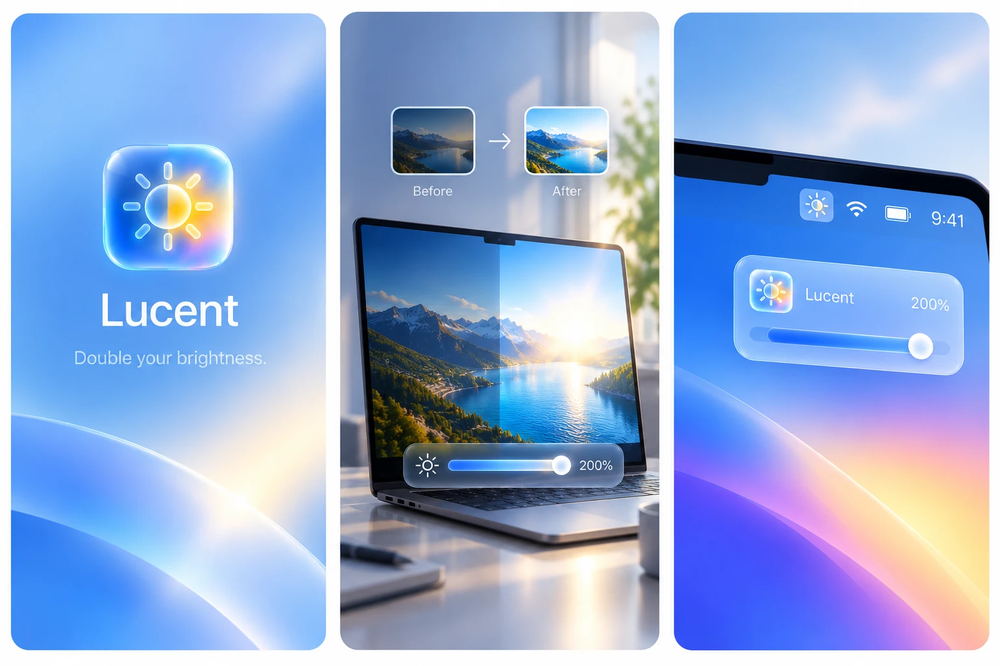

<p align="center">
  
</p>

<h1 align="center">Lucent</h1>

<p align="center"><b>Unlock the full XDR brightness of your MacBook Pro.</b><br>
Free, open-source, native. A tiny menu bar app written in Swift.</p>

<p align="center">
  
</p>

## What it does

MacBook Pro Liquid Retina XDR panels can reach 1000 nits full-screen (1600 nits peak), but macOS caps everyday content at 500 nits. Lucent lifts that cap.

- **One brightness scale.** Your brightness keys keep working as usual: 0 → 500 nits is the native range, then they keep going past the native maximum, up to **1000 nits** in 50-nit steps.
- **One HUD.** A system-style overlay shows the level in nits. No duplicate overlays.
- **Smooth.** Transitions are animated, with no flashes.
- **Light.** No screen recording, no full-screen overlay. Lucent uses almost no CPU and no GPU.
- **Safe.** macOS restores the display automatically if Lucent quits or crashes. A built-in ceiling turns boosting off if anything goes wrong.

Hold <kbd>⌥</kbd><kbd>⇧</kbd> with a brightness key for quarter steps, like macOS. <kbd>⌃</kbd><kbd>⌥</kbd><kbd>⌘</kbd><kbd>V</kbd> toggles Lucent from anywhere.

## Requirements

- A Mac with an XDR display: MacBook Pro 14"/16" (M1 Pro and later) or Pro Display XDR
- macOS 13 or later
- Accessibility permission, so Lucent can handle the brightness keys

## Install

### Download

1. Download `Lucent-1.0.zip` from the [latest release](https://github.com/Azilone/Lucent/releases/latest), unzip it, and move **Lucent.app** to **Applications**.
2. The app isn't notarized, so macOS blocks it on first launch. Open it once, then go to **System Settings › Privacy & Security** and click **Open Anyway**. Or run:
   ```bash
   xattr -dr com.apple.quarantine /Applications/Lucent.app
   ```
3. Allow Lucent in **System Settings › Privacy & Security › Accessibility**, then relaunch it.

### Build from source

Build from source (Xcode Command Line Tools required):

```bash
git clone https://github.com/Azilone/Lucent.git
cd Lucent
./build.sh --install
open /Applications/Lucent.app
```

On first launch, allow Lucent in **System Settings › Privacy & Security › Accessibility**.

## Performance

- **CPU:** 0% when idle. Lucent does work only when you press a brightness key or move the slider.
- **Memory:** about 12 MB.
- **Battery:** the app itself costs nothing measurable. The extra brightness does: driving the panel at 1000 nits uses noticeably more power than 500 nits, just like any other way of reaching that brightness. At native brightness (≤ 500 nits), Lucent leaves the display untouched.

## How it works

1. A single 1×1 pt window renders one pixel with an EDR value above 1.0. This switches the panel into extended dynamic range mode, so it reserves brightness headroom.
2. The display's gamma table is then scaled above 1.0. This maps regular SDR content into that headroom.
3. The target ratio is linear (`nits / 500`). It is converted to the table's gamma-encoded space (`ratio^(1/2.2)`) and capped at 1000 nits.
4. Brightness keys are intercepted with an event tap. Below the native maximum, Lucent sets the native brightness (via `DisplayServices`). Above it, Lucent drives the boost.

Gamma tables are owned by the process. When Lucent exits, for any reason, macOS puts the original table back.

## Troubleshooting

- **The keys do nothing past 100%:** check the Accessibility permission, then relaunch Lucent.
- **Something looks wrong:** press <kbd>⌃</kbd><kbd>⌥</kbd><kbd>⌘</kbd><kbd>V</kbd>, or run `pkill -x Lucent`.
- **Logs:** `log show --last 10m --predicate 'process == "Lucent"' | grep Lucent:`

`Tools/gamma-probe.swift` checks that your Mac keeps a gamma table above 1.0 while in EDR mode.

## Credits

Inspired by [Vivid](https://www.getvivid.app/), [BrightIntosh](https://github.com/niklasr22/BrightIntosh) and [BrightXDR](https://github.com/starkdmi/BrightXDR). Lucent is an independent implementation and is not affiliated with them.

## License

[MIT](LICENSE)
